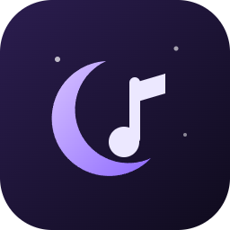

<p align="center"></p>

<h1 align="center">Noxelyra Music</h1>
<p align="center"><b>Windows 11 için hafif, koyu cam görünümlü müzik ve video oynatıcı.</b><br>
<sub>A light, dark-glass music and video player for Windows 11 that works with Noxelyra's dynamic island.</sub></p>

> [!TIP]
> ### 📥 Nasıl kurulur? (30 saniye)
> 1. **[Noxelyra-Music-Setup.exe'yi indir](https://github.com/Claxe-exe/Noxelyra-Music/releases/latest/download/Noxelyra-Music-Setup.exe)** (yerel dosyalar + YouTube, her zaman en son sürüm)
> 2. İndirdiğin dosyayı çalıştır. Windows "*bilgisayarınızı korudu*" derse **Ek bilgi → Yine de çalıştır**'a bas (dosya imzasız olduğu için çıkar).
> 3. Bu kadar! Noxelyra Music masaüstüne ve Başlat menüsüne eklenir. Yönetici izni istemez.
>
> Spotify için ayrı uygulama: **[Noxelyra-Stream-Setup.exe](https://github.com/Claxe-exe/Noxelyra-Music/releases/latest/download/Noxelyra-Stream-Setup.exe)** (Spotify Premium ve kendi Spotify geliştirici uygulaman gerekir; aşağıya bak).
>
> ⚠️ Yeşil **Code → Download ZIP** düğmesi uygulamayı değil **kaynak kodunu** indirir. **Gereken:** Windows 11 x64 ve [.NET 10 çalışma zamanı](https://dotnet.microsoft.com/download/dotnet/10.0) (Windows medya kontrolleri için).

Noxelyra'nın dinamik adasıyla uyumlu çalışır. Noxelyra uygulamaya karışmaz; onu yalnız Windows'un resmi medya (SMTC) ve ses (Core Audio) arayüzleri üzerinden okur.

Aynı koddan iki uygulama çıkar:

| Uygulama | Exe ve AppUserModelID | Kaynaklar | Electron |
|---|---|---|---|
| **Noxelyra Music** | `Noxelyra Music.exe` / `Noxelyra Music` | Yerel dosyalar + YouTube | Normal Electron 43 |
| **Noxelyra Stream** | `Noxelyra Stream.exe` / `Noxelyra Stream` | Spotify | castLabs Electron 43 (Widevine) |

**Neden iki uygulama?** Spotify Geliştirici Politikası (III.5), Spotify içeriği sunan bir ürünün başka bir servisin akışlarıyla birleşmesini yasaklıyor. YouTube ve Spotify tek uygulamada olursa bu kural çiğnenir. İki ayrı uygulama yaptım; ikisi de Noxelyra'yla aynı şekilde çalışır.

## Kurulum ayrıntıları

Kurulum kullanıcı kapsamındadır, yönetici izni istemez. Masaüstü ve Başlat menüsü kısayolu ekler; kısayolun AppUserModelID'si exe adıyla aynıdır. Kaynaktan derlediysen kurmadan `dist\<sürüm>\win-unpacked\` klasöründeki exe'yi de çalıştırabilirsin. O durumda uygulama ilk açılışta yalnız kendi Başlat menüsü kısayolunu yazar. Windows medya kartı uygulamanın adını bu kısayoldan okur; kısayol yoksa "Bilinmeyen uygulama" yazar.

**Gereken:** Windows 11 x64 ve .NET 10 çalışma zamanı (bu bilgisayarda kurulu). SMTC köprüsü .NET ile yazıldı. .NET yoksa uygulama yine çalışır, ama medya kontrollerini Chromium'un kendi yolu yayınlar. Bu yolda YouTube ve Spotify için başlık ve kapak eksik kalabilir.

## Kullanım

- **Kitaplık:** Varsayılan olarak Müzik klasörü taranır. Ayarlar'dan klasör ekleyebilirsin. Dosya veya klasörü pencereye sürükleyince hemen çalar. Desteklenen biçimler: MP3, FLAC, M4A, AAC, OGG, Opus, WAV ve video olarak MP4, WebM, MOV (MKV'de codec'e bağlı).
- **YouTube'da ara:** YouTube sekmesinde YouTube'un kendi sitesi açılır. Arayıp bir videoya, Shorts'a ya da oynatma listesine tıklayınca o sayfada değil, Noxelyra Music'in oynatıcısında çalar. Panelde arayabilmen için köşedeki küçük oynatıcıda çalar. Panel uygulamanın geri kalanından ayrı bir oturumda çalışır ve sesi kapalıdır. İlk açılışta, panelde Google hesabıyla giriş yapmaman gerektiğini anlatan bir onay metni çıkar; panelde giriş sayfaları da engellenir. Uygulama sayfadan veri okumaz, video indirmez. Not: Bu yöntem YouTube'un resmi API'si değil, sitenin kendisidir. YouTube kuralları bunu açıkça yasaklamıyor ama açıkça izin de vermiyor; bir gri alan.
- **YouTube:** Video veya oynatma listesi bağlantısını yapıştır, hemen çalar; giriş gerekmez. Arama, oynatma listelerin ve beğendiklerin için Google ile giriş yapabilirsin. Bunun için kendi ücretsiz Google Cloud OAuth istemcin gerekir; adımlar Ayarlar'da.
- **Spotify (Noxelyra Stream):** Spotify Premium ve kendi Spotify geliştirici uygulaman gerekir. Redirect URI: `http://127.0.0.1:47863/oauth/spotify`. Adımlar Ayarlar'da.
- **Kısayollar:** Boşluk oynat/duraklat, ←/→ ±10 sn, Ctrl+F ara, Esc sahneden çık.
- **YouTube'da küçültme:** YouTube videosu açıkken pencereyi küçültünce pencere simge durumuna geçmez, köşede her zaman üstte duran bir mini oynatıcıya dönüşür (356×200 video alanı ve üstte 28 px şerit). Şeridi sürükleyerek mini oynatıcıyı taşıyabilir, şeride tıklayarak normal pencereye dönebilirsin. Kenarından boyutunu değiştirebilirsin; boyut 16:9 oranında kalır. Simge durumundaki pencerenin görüntüsünü Windows hiçbir uygulamaya vermediği için bu gerekli; mini oynatıcı sayesinde video Noxelyra adasında görünmeye devam eder. Ayarlar → YouTube → "Küçültünce mini oynatıcıya geç" ile kapatılabilir; kapalıyken küçültülmüş pencerenin videosu adada görünmez.
- **Arka plana al:** Pencere simge durumuna küçültülmez, ekran dışına taşınır. Bu sayede video çizilmeye devam eder ve Noxelyra görüntüyü alabilir. Görev çubuğu ya da tepsi simgesi pencereyi geri getirir. Yerel video oynarken küçült düğmesi de aynı şeyi yapar. YouTube'da bu özellik kapalıdır; ayrıntı aşağıda.

## Noxelyra uyumu: neler yapıldı

1. **SMTC:** `smtc/Bridge.cs`, `SystemMediaTransportControlsInterop.GetForWindow` ile uygulamanın kendi penceresine bağlanır ve Electron ana işleminde node-api-dotnet ile çalışır; ayrı bir işlem yoktur. Yayınlananlar: başlık, sanatçı, albüm ve 512×512 kare kapak. Oynuyor/duraklatıldı durumu, oynat/duraklat/sonraki/önceki, zaman çizelgesi (başlangıç, bitiş, konum) da yayınlanır. Konum oynarken her saniye ve her sarmada güncellenir. Sarma `MinSeekTime/MaxSeekTime` ile açıktır, yani `IsPlaybackPositionEnabled = true` olur. `PlaybackPositionChangeRequested` işlenir. Chromium'un kendi SMTC'si kapatıldı (`HardwareMediaKeyHandling`), çünkü YouTube ve Spotify oynatıcıları iframe içinde çalıştığından Chromium doğru başlığı ve kapağı yayınlayamaz.
2. **AppUserModelID:** `app.setAppUserModelId(<exe adı>)` kullanılır, kısayollar da aynı kimliği taşır.
3. **Ses:** `AudioServiceOutOfProcess` kapalıdır, dolayısıyla ses Chromium'un ayrı ses işleminde değil ana işlemde çalar. Bu, Windows'un normal paylaşımlı oturumudur. Ses karıştırıcısında oturum `Noxelyra Music` adıyla görünür.
4. **Video:** Video, uygulamanın kendi üst düzey penceresinde çizilir. Pencere başlığı `Parça — Sanatçı · Noxelyra Music` biçimindedir. `backgroundThrottling: false` ve `--disable-features=CalculateNativeWinOcclusion` açıktır, böylece pencere başka pencerelerin altında kaldığında da çizim sürer.

## Gizlilik

Telemetri ve analiz yoktur. Uygulama yalnız seçtiğin kaynak için ağ isteği yapar:

- **Noxelyra Music:** YouTube oynatıcısı (`youtube-nocookie.com`, YouTube'un kendi reklam ve video sunucuları), başlıklar için YouTube oEmbed ve kapak resimleri için `i.ytimg.com`. Giriş yaptıysan bunlara Google OAuth ve YouTube Data API eklenir. Yerel dosyalar bilgisayarından çıkmaz.
- **Noxelyra Stream:** Spotify girişi, Spotify Web API, Web Playback SDK ve Spotify'ın akış ve kapak sunucuları. Bunlara bir de Widevine DRM bileşeni eklenir: castLabs Electron bu bileşeni Google'ın bileşen güncelleme sunucusundan indirir. Spotify'ın şifreli akışı için zorunludur.

Uygulama içinde `127.0.0.1` üzerinde küçük bir yerel sunucu çalışır ve dışarıya kapalıdır. Üç işi vardır: YouTube oynatıcısı geçerli bir sayfa kaynağı ister, OAuth dönüş adresi loopback olmalıdır ve yerel dosyalar sarılabilir biçimde akıtılır. Giriş belirteçleri Windows DPAPI ile şifrelenir. Hesap verileri (listeler, arama sonuçları) diske yazılmaz. Yazım denetimi kapalıdır, bu yüzden sözlük indirilmez.

## Kullanım şartları ve lisanslar

**İndirme ve kopyalama yöntemini reddettim.** "Giriş yapınca şarkıyı veya klibi kendine al" yaklaşımı YouTube Hizmet Şartları'na ve YouTube API politikasına aykırıdır (III.E.1: indirme, önbelleğe alma, çevrimdışı oynatma yasak). Spotify Kullanım Koşulları da bunu yasaklar, ayrıca Spotify'ın DRM'ini aşmak gerekir. Bunların yerine iki servisin de resmi oynatıcısı kullanılıyor.

**YouTube (YouTube API Hizmetleri Şartları ve Geliştirici Politikaları):**
- Resmi IFrame Player API kullanılır. Oynatıcı her zaman görünürdür; logo, bağlantılar ve reklamlar olduğu gibi kalır (III.I.4–6).
- Ses görüntüden ayrılmaz (III.I.7).
- Arka planda veya görünmeyen oynatıcıda oynatma yoktur (III.I.9). Bu yüzden YouTube çalarken "arka plana al" kapalıdır, uygulama arayüzü de oynatıcının üstünü örtmez.
- Data API için kendi Google Cloud projen gerekir; uygulamaya API anahtarı gömülmez (III.D.1). Yalnız okuma izni (`youtube.readonly`) istenir. Çıkış yapınca izin hemen geri alınır (III.D.2).
- Bilinen sınırlama: sahibi gömülü oynatmayı kapattığı videolar çalmaz. YouTube Music'e özel bazı içerikler (yüklemelerin, bazı "Topic" parçaları) gömülü oynatıcıda açılmayabilir. YouTube Music'in resmi bir API'si yoktur.
- YouTube Premium'un reklamsız oynatma ayrıcalığı gömülü oynatıcıda geçerli olmayabilir.

**Spotify (Geliştirici Şartları ve Politikası):**
- Web Playback SDK yalnız **Premium** hesapta çalar (IV.1).
- Şubat 2026'dan beri geliştirme modu, uygulama sahibinin Premium olmasını şart koşuyor. Uygulama başına en çok 5 kullanıcı ve geliştirici başına 1 Client ID var. Arama sonuç sayısı en çok 10'dur. Başkasının oynatma listesinin içeriği okunamaz; bu listeler "Listeyi çal" ile bağlamıyla çalınır.
- Ticari kullanım yasaktır (IV.2). Bu uygulama kişisel kullanım içindir.
- Spotify içeriği başka bir servisin içeriğiyle birleştirilmez (III.5); bu yüzden ayrı uygulama yapıldı. Görsel medyayla eşlenmez (III.6). Başka seslerle karıştırılmaz (III.7).
- Kapak ve bilgiler gösterilir, çalan parça Spotify'a bağlanır ("Spotify'da aç") (II.4–II.5). Spotify'ın marka kılavuzu atıf için Spotify logosunu ister. Ben logo dosyalarını uygulamaya koymadım, yalnız "Spotify'da aç" yazısı var. Uygulamayı başkalarıyla paylaşacaksan Spotify'ın resmi logo paketini eklemelisin.
- Uygulama adı "Spot" ile başlamaz (VI.2).
- III.11, ürünün Spotify'ın temel deneyimini taklit etmek yerine bağımsız değer katmasını ister. Bu uygulamanın kattığı değer Noxelyra entegrasyonu ve sade arayüzdür. Yine de "Spotify istemcisi gibi bir oynatıcı" olduğu için bu bir gri alandır. Kişisel kullanımda sorun beklemem, ama dürüstçe belirtiyorum.
- **Widevine VMP:** castLabs Electron, Widevine'i kendisi indirir. Windows'ta bazı servisler VMP imzalı uygulama ister. Spotify şifre çözmede hata verirse castLabs'ın ücretsiz EVS hesabıyla imzalaman gerekir (`pip install castlabs-evs`, `python -m castlabs_evs.account signup`, `python -m castlabs_evs.vmp sign-pkg "dist\stream\win-unpacked"`). Hesabı senin açman gerekir.

**Lisanslar:** Bu proje MIT lisanslıdır (`LICENSE`). Kullanılan bileşenler:

| Bileşen | Lisans |
|---|---|
| Electron | MIT |
| castLabs Electron for Content Security | MIT; Widevine CDM Google'a aittir ve çalışma anında indirilir, pakete konmaz |
| music-metadata | MIT |
| node-api-dotnet | MIT |
| .NET ve CsWinRT | MIT |
| Chromium | BSD ve diğerleri; ayrıntı `LICENSES.chromium.html` dosyasında |

## Geliştirme

```
npm install
npm start                # Noxelyra Music (geliştirme)
npm run start:stream     # Noxelyra Stream (castLabs Electron)
npm run dist             # iki kurulum dosyasını da üretir (dist\music, dist\stream)
npm run release          # sürümü artırır, iki kurulum dosyasını derler, GitHub'a iter ve yeni sürüm (release) yayınlar
```

`NOX_DATA=<klasör>` ile ayrı bir veri klasöründe denenebilir; gerçek ayarlara dokunmaz.
